# ContextFlow

**Never lose a coding session to a usage limit again.**

ContextFlow runs your coding agent for you. When it runs out of usage (Claude Code's session or weekly limit, Codex's usage limit), ContextFlow writes a handoff brief and starts the next agent on the same repo, so the work keeps going. When every agent is out, it waits for the earliest reset and carries on.

<p align="center"></p>

### Try it in 10 seconds

No agent accounts needed. The demo runs the real orchestrator, adapters, git checkpoints and handoff brief against a throwaway repo; only the two agents are simulated.

```sh
git clone https://github.com/vaibxx/ContextFlow && cd ContextFlow
npm install && npm run demo
```

## Supported agents

| Agent | id | Status |
|---|---|---|
| [Claude Code](https://code.claude.com) | `claude` | Supported |
| [Codex CLI](https://github.com/openai/codex) | `codex` | Supported |
| Antigravity CLI, others | | [Add one!](CONTRIBUTING.md) |

Each agent runs with your own login. ContextFlow never sees or stores credentials.

## Install

Requires Node.js 22+ and git. Works on macOS, Linux and Windows.

```sh
npm install -g contextflow     # once published
# or from source:
git clone https://github.com/vaibxx/ContextFlow && cd ContextFlow
npm install && npm run build && npm link
```

Install and log in to at least one agent first (`claude`, `codex`). Check with:

```sh
cf agents
```

## Usage

```sh
cd your-project
cf run "add a dark mode toggle to the settings page"
```

| Command | What it does |
|---|---|
| `cf run "<task>"` | Start a task with the first agent in the chain |
| `cf resume` | Continue the session in this folder (after Ctrl+C, a failure, or `--no-wait`) |
| `cf status` | Show which agents ran, what happened, and when limits reset |
| `cf agents` | List supported agents and whether they're installed |
| `cf init` | Write `contextflow.config.json` with the defaults |
| `cf reset` | Forget the session in this folder (your code and commits stay) |

| Option | |
|---|---|
| `-c, --chain claude,codex` | Agents in handoff order |
| `-a, --ask` | Ask which agent continues at each handoff |
| `-y, --yes` | Let agents edit files **and run commands** without asking. Needed for real unattended work. |
| `--no-branch` | Stay on the current branch instead of `contextflow/<session>` |
| `--no-checkpoints` | Don't commit after each agent run |
| `--no-wait` | When every agent is out, save and exit with code 75 instead of waiting |

### Config file

`cf init` writes `contextflow.config.json` in your project:

```json
{
  "chain": ["claude", "codex"],
  "autoApprove": false,
  "branch": true,
  "checkpoints": true,
  "ask": false,
  "wait": true,
  "maxWaitMinutes": 10080,
  "defaultWaitMinutes": 60,
  "agents": {
    "claude": { "model": "sonnet" },
    "codex": { "args": ["-c", "model_reasoning_effort=high"] }
  }
}
```

Command-line options override the file.

## How it works

1. **Branch.** ContextFlow switches to `contextflow/<session>` so agents never touch your main branch directly.
2. **Run headless.** It starts the agent in its non-interactive mode (`claude -p --output-format stream-json`, `codex exec --json`) and streams what it does.
3. **Progress notes.** Every agent is told to keep `.contextflow/progress.md` (Plan / Done / Next) current, so a sudden cutoff still leaves a clear trail.
4. **Checkpoint.** After every agent run, it commits the work.
5. **Detect limits.** It reads the agent's error output for limit messages such as *"You've hit your session limit · resets 3:45pm"* and parses the reset time.
6. **Hand off.** It writes a brief (task, progress notes, commits, uncommitted diff, the last agent's final actions and messages) to `.contextflow/handoffs/` and starts the next agent with it. The format is in [docs/handoff-spec.md](docs/handoff-spec.md).
7. **Wait and resume.** When everyone is out, it sleeps until the earliest reset. If the agent coming back was the last one working, it resumes its own native session (`--resume` / `codex exec resume`); otherwise it gets a brief.

Everything ContextFlow keeps lives in `.contextflow/` in your project, which is added to `.git/info/exclude` so it never gets committed.

## Limits you should know about

- **Handoff happens when the limit hits, not before.** Neither CLI exposes "credits remaining" in headless mode, so ContextFlow reacts to the limit error. The agent's progress notes and the per-run checkpoint are what make that safe.
- **The model's memory doesn't move, only a written brief does.** The next agent re-reads the code. In practice this works well; it's why the progress notes matter.
- **Headless means no interactive TUI.** You watch ContextFlow's log instead of the agent's own interface.
- **Use your own accounts.** ContextFlow switches between different providers you're subscribed to. Don't use it to rotate multiple accounts on one provider; that likely breaks their terms.
- **Limit messages change.** If an agent changes its wording, update the patterns in its adapter (and send a PR).

## Background and references

ContextFlow's design draws on published work on agents, memory and long contexts:

- **Hand off a brief, not the transcript.** N. F. Liu et al., ["Lost in the Middle: How Language Models Use Long Contexts"](https://aclanthology.org/2024.tacl-1.9/), *TACL* 12, 157–173, 2024. Models use information in the middle of long inputs less reliably, which is why the next agent gets a compact brief (task, progress notes, commits, diff, final actions) instead of the previous agent's full history.
- **Memory outside the context window.** C. Packer et al., ["MemGPT: Towards LLMs as Operating Systems"](https://arxiv.org/abs/2310.08560), arXiv 2023. MemGPT moves information between a model's context and external storage. ContextFlow keeps session state in `.contextflow/` and in git checkpoints, so the work outlives any single agent's context.
- **Written notes carry progress between attempts.** N. Shinn et al., ["Reflexion: Language Agents with Verbal Reinforcement Learning"](https://arxiv.org/abs/2303.11366), NeurIPS 2023. Reflexion agents keep reflective text in memory to do better on later trials. ContextFlow asks every agent to keep `.contextflow/progress.md` (Plan / Done / Next) current, so a sudden cutoff still leaves a trail.
- **Structured handoffs between agents.** S. Hong et al., ["MetaGPT: Meta Programming for A Multi-Agent Collaborative Framework"](https://arxiv.org/abs/2308.00352), ICLR 2024. MetaGPT passes standardized documents between role agents. ContextFlow's [handoff spec](docs/handoff-spec.md) plays that role between different vendors' coding agents.
- **Coding agents working in real repositories.** J. Yang et al., ["SWE-agent: Agent-Computer Interfaces Enable Automated Software Engineering"](https://arxiv.org/abs/2405.15793), NeurIPS 2024. SWE-agent shows how much the interface matters when models edit code and run tests. ContextFlow sits one level up: it orchestrates existing agent CLIs and keeps their work going across usage limits.

## Contributing

New agents are one file each. See [CONTRIBUTING.md](CONTRIBUTING.md).

```sh
npm install
npm test        # builds, then runs unit + end-to-end tests with a fake agent
```

## License

MIT
